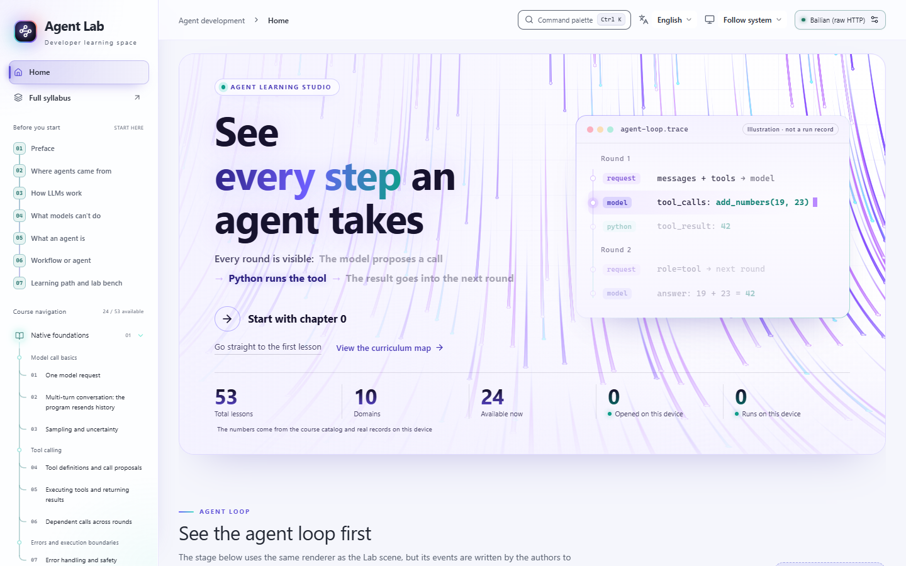
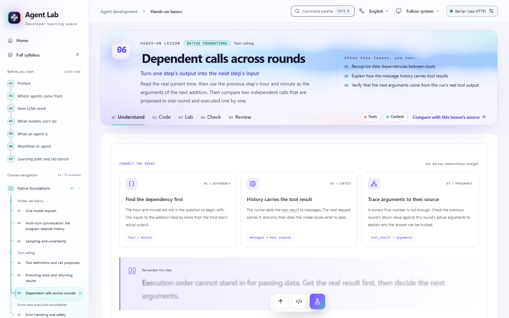
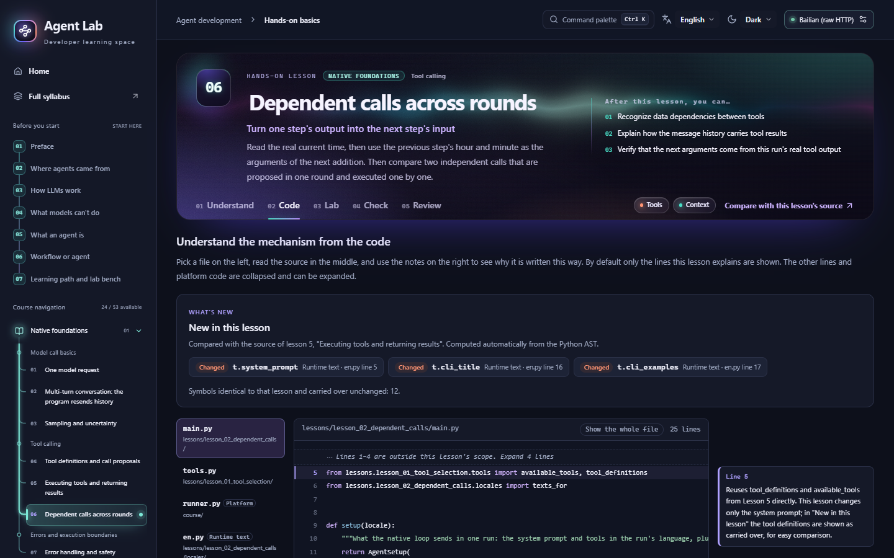
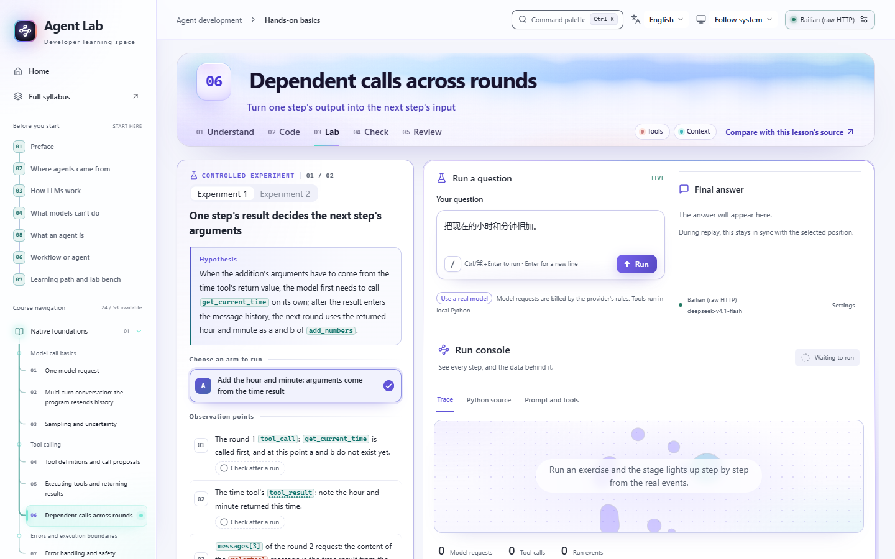
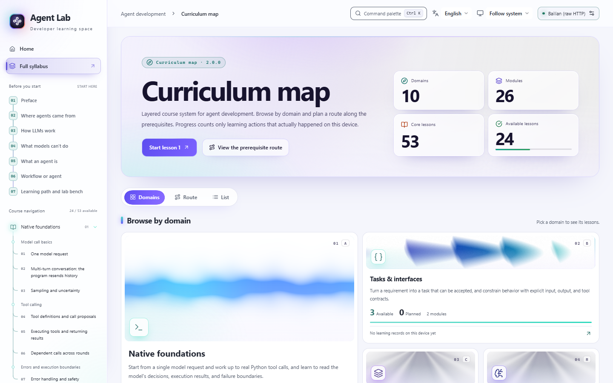
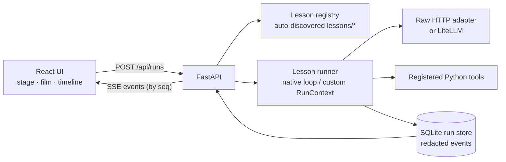

<div align="center">

# Agent Learning Studio

**See what an AI agent does at every step — then build it yourself.**

A local, visual course for programmers who want to understand how LLM agents really work:
hand-write the agent loop in plain Python, then watch every model request, response and tool call it makes.

[](LICENSE)
[](https://www.python.org/)
[](https://nodejs.org/)
[](https://fastapi.tiangolo.com/)
[](https://react.dev/)
[](docs/course-plan.en.md)
[](https://github.com/ZhiQiu-Kinsey/agent-learning-studio/actions/workflows/ci.yml)
[](#contributing)

**English** · [简体中文](README.zh-CN.md)



</div>

> [!NOTE]
> **Fully bilingual: English and 简体中文.** Switch languages from the top bar. The UI, the onboarding, all 24 available lessons, the curriculum and the glossary are translated — and so is the **runtime**: in English, the system prompts, tool descriptions, preset questions and lab reports your run sends and emits are English too, and the Code scene shows the English message catalog that actually runs. Each run records its language, and a replay always shows the run as it happened.

<details>
<summary><b>Table of contents</b></summary>

- [Why this project](#why-this-project)
- [Features](#features)
- [Screenshots](#screenshots)
- [Curriculum](#curriculum)
- [Quick start](#quick-start)
- [Connecting a model](#connecting-a-model)
- [How to learn with it](#how-to-learn-with-it)
- [Architecture](#architecture)
- [Development](#development)
- [Contributing](#contributing)
- [Roadmap](#roadmap)
- [Acknowledgements](#acknowledgements)
- [License](#license)

</details>

## Why this project

Most agent tutorials either hide the loop behind a framework or show static code you have to trust. Agent Learning Studio does the opposite:

- **Start from scratch.** Write an agent loop in a few dozen lines of plain Python, then add context management, memory, planning, workflows and multiple agents one step at a time.
- **Show the evidence.** For every step you see the full request sent to the model, the model's response, the result of the Python tool that actually ran, and an event trace you can replay step by step.
- **Learn frameworks last.** Once the mechanics are clear, LangChain and LangGraph are introduced as wrappers around things you have already built by hand.

## Features

| | |
| --- | --- |
| 🔍 **Evidence first** | Message flows, tool cards, the stage and the timeline are all derived from real run events. Teaching illustrations are drawn with dashed lines and labelled "illustration, not a run record". Replay only reads recorded events — it never calls the model or tools again. |
| 🧭 **One complete loop per lesson** | Every lesson follows **concept → minimal implementation → run evidence → experiment → self-check**, split into five scenes: *Understand*, *Read the code*, *Experiment*, *Self-check* and *Review*. |
| 🧑‍💻 **Real source, real line numbers** | The code scene shows the lesson's actual source with anchored notes. "New in this lesson" is computed from the Python AST, not written by hand. |
| 🧪 **Experiments, not demos** | Each experiment states a hypothesis, control arms, observation points and what the result can and cannot prove. Observation points are checked against your own runs. |
| 📖 **Terms explained in place** | Course terms show a hover card and are marked as new, previously learned or background. Source names in the prose are rendered as code with short notes. |
| 🔌 **Provider-agnostic** | Alibaba Bailian (DashScope) goes through a hand-written raw HTTP path that shows the full request body. OpenAI, Anthropic, Gemini, DeepSeek, OpenRouter, Ollama and any OpenAI-compatible service go through LiteLLM, and the UI honestly labels them as *SDK-standardized* requests and responses. |
| 🗂️ **Curriculum as data** | The catalog, glossary and every lesson's content are JSON validated against schemas. The backend discovers lessons automatically — adding a lesson needs no platform code changes. |
| 🌐 **Bilingual, down to the runtime** | English and Simplified Chinese UI, course text **and runtime**, switchable at any time without losing your place. Course text uses overlays keyed by stable IDs (facts can't be overridden; a translation goes stale and falls back as soon as its source changes). Runtime text lives in typed per-language message catalogs that you read in the Code scene, and tests guarantee an English run emits no Chinese. |
| 🔒 **Local and private** | The server binds to `127.0.0.1` only. API keys stay in the backend and are never written to run records, logs or browser storage. |

## Screenshots

<table>
  <tr>
    <td width="50%"><p align="center"><b>Understand</b> — concept cards, prose, micro-quizzes</p></td>
    <td width="50%"><p align="center"><b>Read the code</b> — real source with anchored notes</p></td>
  </tr>
  <tr>
    <td width="50%"><p align="center"><b>Experiment</b> — hypothesis, observation points, run console</p></td>
    <td width="50%"><p align="center"><b>Curriculum map</b> — 10 domains, prerequisite routes</p></td>
  </tr>
</table>

## Curriculum

The course starts with a 7-chapter onboarding (no model calls needed), then runs through ten domains — from a single model request to shipping a local assistant.

| # | Domain | What you learn | Status |
| --- | --- | --- | --- |
| A | Native foundations | One model request, multi-turn history, sampling; tool definitions, executing tools, dependent calls, error boundaries | ✅ 7 / 7 |
| B | Tasks & interfaces | Acceptance criteria, structured output with business validation, prompts & tool descriptions | ✅ 3 / 3 |
| C | Context & state | Message protocol, app state, context budgets & compaction, persistent memory, prompt caching, Skills & progressive disclosure | ✅ 8 / 8 |
| R | Reasoning & control | Text actions vs. native tool calls, TODO planning, plan-and-replan, bounded reflection, workflow patterns, orchestrator–workers & evaluator–optimizer | ✅ 6 / 6 |
| D | Knowledge & retrieval | Chunking, BM25, embeddings, hybrid search & reranking, RAG with citations, agentic RAG | 🚧 0 / 6 |
| E | Frameworks & orchestration | LangChain vs. native, LangGraph state & branches, streaming & cancellation, approvals, human-in-the-loop & recovery | 🚧 0 / 7 |
| K | Coding agents & sandboxes | A single-bash-tool coding agent, file tools and change evidence | 🚧 0 / 2 |
| F | Quality & reliability | Eval sets & validators, observability & cost, reliable tools, prompt injection & permissions | 🚧 0 / 4 |
| G | Protocols & tool services | MCP fundamentals, connection lifecycle, A2A delegation | 🚧 0 / 3 |
| H | Capstone & delivery | Multi-agent trade-offs, long-running tasks, local delivery, capstone project | 🚧 0 / 7 |

The full syllabus — difficulty, estimated time, whether a lesson calls a model, sections, terms, objectives, experiments and acceptance criteria — is in [docs/course-plan.en.md](docs/course-plan.en.md) ([Chinese version](docs/course-plan.md)). Planned lessons are greyed out in the UI and only open once they are implemented, tested and reviewed.

## Quick start

**Prerequisites:** Python 3.12+, [uv](https://docs.astral.sh/uv/), Node.js 22.12+ and npm.

```bash
git clone https://github.com/ZhiQiu-Kinsey/agent-learning-studio.git
cd agent-learning-studio

uv sync --dev                     # Python dependencies
npm --prefix frontend ci          # frontend dependencies
npm --prefix frontend run build   # type-check and build the UI
.venv/bin/python run_web.py       # start the server
```

On Windows (PowerShell), use `npm.cmd` instead of `npm` and `.\.venv\Scripts\python.exe run_web.py` to start, or simply run `start-web.ps1`.

Open **http://127.0.0.1:8765**. Next time you only need the last command.

## Connecting a model

Pick a provider in **Model connection settings** (top-right of the page), enter a model ID and, if needed, an API base URL and key.

- Settings entered in the browser live only in backend memory; after a restart the server falls back to environment variables and local files.
- Existing keys and URLs are never echoed back to the browser.

You can also configure providers ahead of time with environment variables:

| Provider | Key | Model / base URL |
| --- | --- | --- |
| Alibaba Bailian (raw HTTP) | `DASHSCOPE_API_KEY` | `MODEL` / `API_URL` in `local_config.py` |
| OpenAI | `OPENAI_API_KEY` | `OPENAI_MODEL` / `OPENAI_BASE_URL` |
| Anthropic | `ANTHROPIC_API_KEY` | `ANTHROPIC_MODEL` / `ANTHROPIC_BASE_URL` |
| Google Gemini | `GEMINI_API_KEY` | `GEMINI_MODEL` / `GEMINI_API_BASE` |
| DeepSeek | `DEEPSEEK_API_KEY` | `DEEPSEEK_MODEL` / `DEEPSEEK_BASE_URL` |
| OpenRouter | `OPENROUTER_API_KEY` | `OPENROUTER_MODEL` / `OPENROUTER_BASE_URL` |
| Ollama | optional `OLLAMA_API_KEY` | `OLLAMA_MODEL` / `OLLAMA_BASE_URL` (defaults to local port 11434) |
| OpenAI-compatible | `CUSTOM_API_KEY` | `CUSTOM_MODEL` / `CUSTOM_API_BASE` |

- **Bailian:** copy `local_config.example.py` to `local_config.py` and fill in the endpoint and a model that supports tool calling. The file is git-ignored.
- **Credentials are isolated:** switching providers never borrows another provider's key.
- **Ollama:** bring your own local server and a tool-calling model; nothing is downloaded automatically.

> [!IMPORTANT]
> Runs in the web UI call a real model and consume your provider quota. Without a working configuration the UI guides you through setup — it never fabricates an answer. Details and limitations: [docs/architecture/multi-provider-review.md](docs/architecture/multi-provider-review.md).

## How to learn with it

1. Read the **Before you start** onboarding in the sidebar. Onboarding and self-checks never call a model.
2. Configure a model in **Model connection settings**. Some lessons run local Python only and need no model.
3. Open a lesson and work through **Understand → Read the code → Experiment → Self-check**. Use the presets, or ask your own question and swap models.
4. Pick a run record in the lab, step through or play the replay, and compare requests, responses and tool results against the observation points.

## Architecture



- **Event envelope v2.** Every run is a sequence of events (`run_start`, `request`, `response`, `tool_call`, `tool_result`, `answer`, `error`, `done`, plus lesson-specific `lesson.*`) carrying `run_id`, `seq` and spans. Events are redacted, stored in SQLite and streamed over SSE with resume by `seq`.
- **Two runner kinds.** `native` lessons reuse the hand-written tool loop; `custom` lessons orchestrate their own flow, but only through `RunContext` (call the model, call tools, emit events, check cancellation).
- **Content v2.** Each lesson's `content.json` is defined by a single schema with stable block IDs, so translation layers can override text without touching facts.

```text
course/        model requests, provider adapters, the native agent loop, RunContext
server/        FastAPI routes, lesson discovery & validation, content schema, event envelope, run store
lessons/       one folder per lesson: lesson.json, content.json, Python code, fixtures, tests
curriculum/    catalog.json (single source of truth), glossary.json, onboarding, JSON Schemas
frontend/      React + TypeScript + Vite + Tailwind CSS 4
scripts/       validation, code generation, lesson scaffolding, recordings, terminology reports
tests/         Python tests (browser tests live in frontend/e2e/)
docs/          syllabus and architecture docs
```

Run records are stored redacted in `.runtime/runs.sqlite3`; learning progress lives in your browser's local storage.

## Development

```bash
uv run python -m unittest discover -s tests       # all Python tests (incl. every lesson's test_lesson.py)
uv run python scripts/validate_lessons.py         # manifests, content, glossary, wording, recordings, translations
uv run python scripts/translation_kit.py status --locale en   # translation coverage per lesson / onboarding / catalog / glossary
uv run python scripts/cjk_baseline.py --check     # hardcoded Chinese in lesson and platform code only goes down
npm --prefix frontend run build                   # type-check and build
npm --prefix frontend run test                    # frontend unit tests (vitest)
npm --prefix frontend run i18n:check              # translation keys are consistent
```

Browser tests (Playwright, system Chrome): build the frontend, start the backend, then run `npx playwright test` in `frontend/`. Set `AGENT_LAB_URL` to test against another port.

Automated tests swap the model for deterministic fixtures at the network boundary, **but still execute the real Python tools**. Fixtures exist only for tests — the web UI has no simulated mode. Every exercise runs offline in every language its lesson supports, and English runs are checked to contain no Chinese.

## Contributing

Contributions of all kinds are welcome — new lessons, clearer prose, bug fixes and translations. Please read these first:

- [AGENTS.md](AGENTS.md) — project rules, commands and conventions (for humans and coding agents alike)
- [Adding lessons](docs/architecture/adding-lessons.en.md) — from registering a lesson to opening it
- [Terminology](docs/architecture/terminology.en.md) — glossary rules, the unified wording table and the checks on English text
- [Validation](docs/architecture/validation.en.md) — test and check commands
- **Translations:** `scripts/translation_kit.py` exports untranslated strings, checks placeholders and inline code, and writes the overlay files (`content.<lang>.json`, `lesson.<lang>.json`, `catalog.<lang>.json`, …). See [Localizing a lesson](docs/architecture/localizing-lessons.en.md) for the checklist and English style.
- [Platform](docs/architecture/platform.en.md) · [Frontend](docs/architecture/frontend-workspace.en.md) · [Event envelope v2](docs/architecture/event-envelope-v2.en.md)
- [Documentation index](docs/README.md) — every doc, with its languages

Community: [Contributing guide](CONTRIBUTING.md) · [Code of conduct](CODE_OF_CONDUCT.md) · [Security policy](SECURITY.md)

A few non-negotiables, each guarded by tests or validators:

1. Run data comes only from real events — never fabricated for effect.
2. Replay is read-only.
3. SDK-standardized payloads are never presented as raw HTTP.
4. Secrets stay in the backend.
5. In a PR, report offline-test results and real-model verification separately (model, samples, call count).

## Roadmap

- [x] Native foundations, tasks & interfaces, context & state, reasoning & control (24 lessons)
- [x] 7-chapter onboarding, curriculum map, guided replay, experiment reports
- [ ] Knowledge & retrieval (RAG)
- [ ] LangChain / LangGraph, human-in-the-loop and recovery
- [ ] Coding agents with sandboxing
- [ ] Evaluation, observability and reliable tools
- [ ] MCP and A2A
- [ ] Multi-agent systems, long-running tasks and the capstone
- [x] English UI and course translation (onboarding, 24 lessons, curriculum, glossary)
- [x] Bilingual runtime: prompts, tool descriptions, presets and reports in the learner's language; English code comments
- [x] Open-source essentials: contributing guide, code of conduct, security policy, issue/PR templates, CI
- [ ] More languages

## Acknowledgements

The curriculum design draws on the following tutorials. Reading scope, pinned versions and licenses are recorded in [docs/architecture/reference-study.en.md](docs/architecture/reference-study.en.md); none of them is a runtime dependency.

- [Microsoft AI Agents for Beginners](https://github.com/microsoft/ai-agents-for-beginners)
- [Hugging Face Agents Course](https://github.com/huggingface/agents-course)
- [*Understanding AI Agents in Depth* (深入理解 AI Agent)](https://github.com/bojieli/ai-agent-book)
- [Anthropic claude-cookbooks](https://github.com/anthropics/claude-cookbooks)

UI components are built with [React Bits](https://reactbits.dev), [shadcn/ui](https://ui.shadcn.com) and [Tailwind CSS](https://tailwindcss.com).

## License

Released under the [MIT License](LICENSE).

Third-party code keeps its own license — notably the React Bits components in `frontend/src/components/react-bits/` (MIT + Commons Clause). See [THIRD_PARTY_NOTICES.md](THIRD_PARTY_NOTICES.md).
