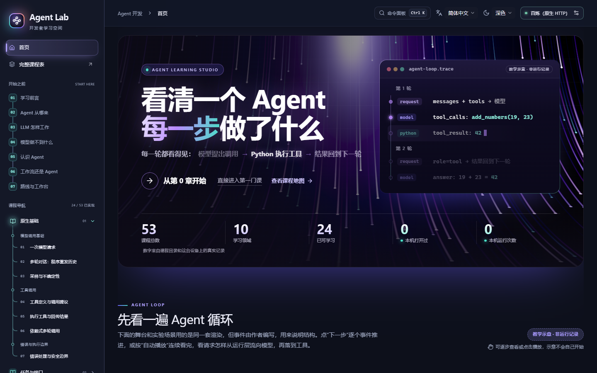
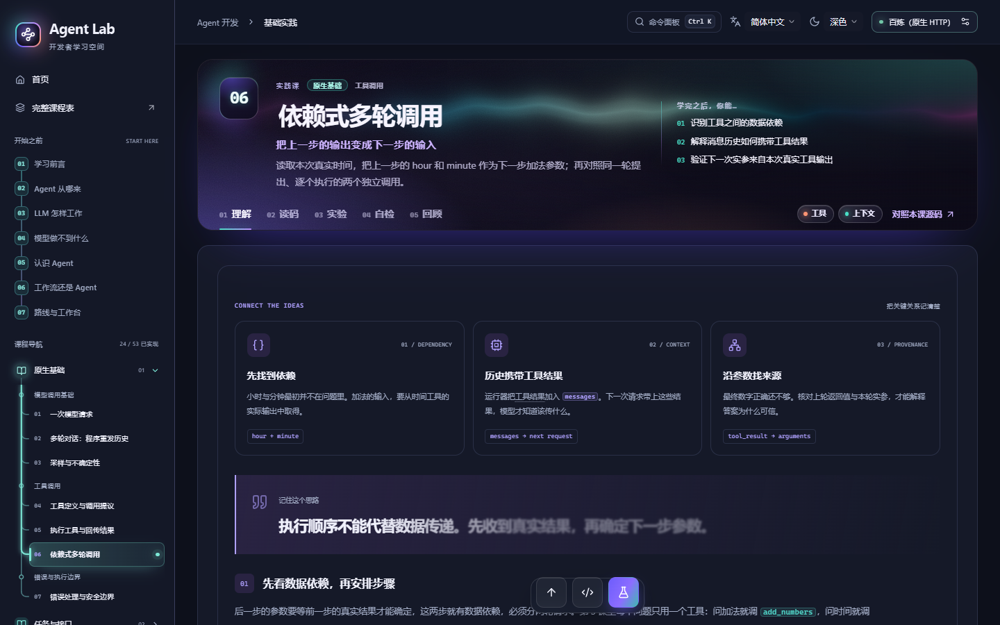
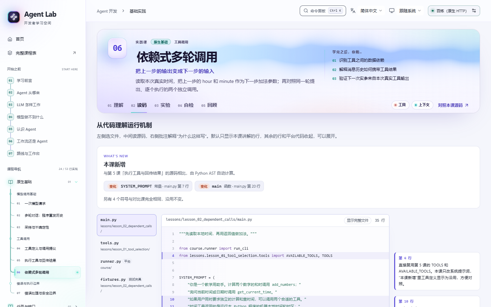
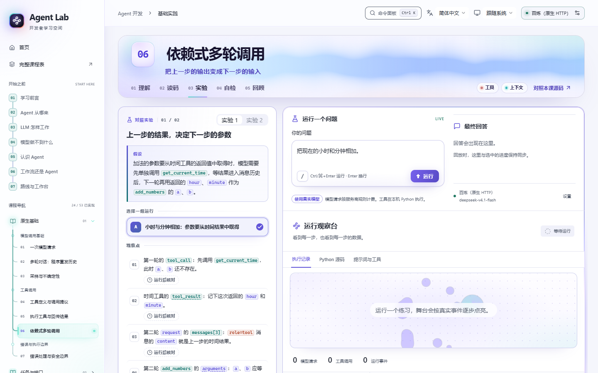
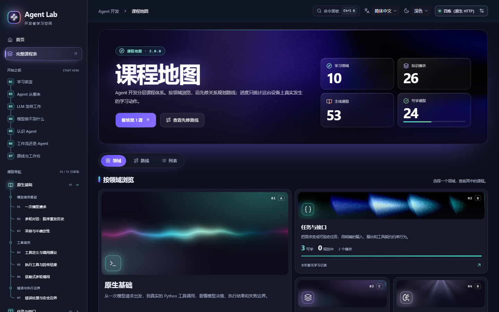
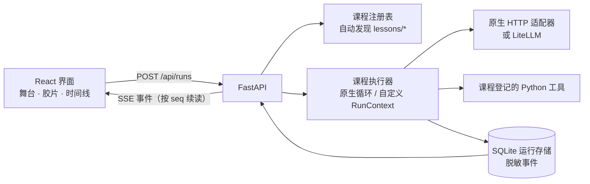

<div align="center">

# Agent Learning Studio

**看清一个 Agent 每一步做了什么，再亲手把它写出来。**

一个在本机运行的 Agent 可视化教学平台，面向有编程基础、想弄懂 Agent 原理的学习者：
先用原生 Python 手写 Agent 循环，再在网页里看它发出的每一次模型请求、收到的每一次响应和执行的每一个工具。

[](LICENSE)
[](https://www.python.org/)
[](https://nodejs.org/)
[](https://fastapi.tiangolo.com/)
[](https://react.dev/)
[](docs/course-plan.md)
[](#参与贡献)

[English](README.md) · **简体中文**

<picture>
  <source media="(prefers-color-scheme: dark)" srcset="docs/assets/screenshots/zh-CN/home-dark.png">
  
</picture>

</div>

> [!NOTE]
> **支持简体中文和 English**，在顶栏随时切换。界面、导学、24 门可学课程、课程目录和术语表都有英文版。课程源码、系统提示词、练习预设输入和运行输出保持中文，因为它们就是真实运行的内容；英文正文引用它们时保留原文并附英文说明。

<details>
<summary><b>目录</b></summary>

- [为什么做这个项目](#为什么做这个项目)
- [特点](#特点)
- [界面预览](#界面预览)
- [学什么](#学什么)
- [快速开始](#快速开始)
- [连接模型](#连接模型)
- [怎么用](#怎么用)
- [架构](#架构)
- [开发](#开发)
- [参与贡献](#参与贡献)
- [路线图](#路线图)
- [致谢](#致谢)
- [许可](#许可)

</details>

## 为什么做这个项目

多数 Agent 教程要么把循环藏在框架后面，要么只给一段静态代码。这里反过来：

- **从零写起。** 先用几十行原生 Python 写出 Agent 循环，再一步步加上上下文管理、记忆、规划、工作流和多 Agent。
- **每一步都有证据。** 发给模型的完整请求、模型的响应、Python 工具的真实执行结果，以及可以逐步回放的事件轨迹，都在网页里摆在一起。
- **框架放在最后。** 机制弄清楚之后再学 LangChain 和 LangGraph，看它们封装了哪些你已经手写过的东西。

## 特点

| | |
| --- | --- |
| 🔍 **证据优先** | 消息流、工具卡片、舞台和时间线都来自真实运行事件。教学示意画成虚线，并标注“教学示意 · 非运行记录”。回放只读取已记录的事件，不重新调用模型或工具。 |
| 🧭 **每课一个完整闭环** | 每课按 **概念 → 最小实现 → 运行证据 → 实验 → 自检** 编排，分为理解、读码、实验、自检、回顾五个场景。 |
| 🧑‍💻 **真实源码，真实行号** | 读码场景展示本课真实源码和锚定批注。“本课新增”由后端从 Python AST 计算，不靠手写。 |
| 🧪 **实验不是演示** | 每个实验写明假设、对照组、观察点，以及结果能证明什么、不能证明什么。观察点在你自己的运行里核对。 |
| 📖 **术语就地解释** | 课程术语可悬停查看释义，并区分本课新术语、前面学过的术语和背景知识。正文提到的源码名字显示为代码样式，可附说明。 |
| 🔌 **不绑定服务商** | 百炼走手写的原生 HTTP 路径，展示完整请求体。OpenAI、Anthropic、Gemini、DeepSeek、OpenRouter、Ollama 和 OpenAI 兼容服务经 LiteLLM 接入，界面如实标为“标准化请求/响应”。 |
| 🗂️ **课程即数据** | 课程目录、术语表和每课内容都是带 schema 校验的 JSON。后端自动发现课程，新增一课不用改平台代码。 |
| 🌐 **中英双语** | 界面和课程文本可在中英文之间随时切换，不丢当前进度。译文是按稳定 id 合并的译文层：事实字段（答案、代码引用、选择器）不可覆盖；中文源文本一改，对应译文就视为过期并回落到源文本。 |
| 🔒 **本地、私密** | 服务只监听 `127.0.0.1`。密钥只在后端，不写进运行记录、日志或浏览器存储。 |

## 界面预览

<table>
  <tr>
    <td width="50%"><p align="center"><b>理解</b>：概念卡、正文、微型自测</p></td>
    <td width="50%"><p align="center"><b>读码</b>：真实源码与锚定批注</p></td>
  </tr>
  <tr>
    <td width="50%"><p align="center"><b>实验</b>：假设、观察点、运行观察台</p></td>
    <td width="50%"><p align="center"><b>课程地图</b>：十个领域与先修路线</p></td>
  </tr>
</table>

## 学什么

先读 7 章前置导学（不调用模型），再按十个领域往下学，从一次模型请求一直到交付本地助教。

| # | 领域 | 内容 | 状态 |
| --- | --- | --- | --- |
| A | 原生基础 | 一次模型请求、多轮对话、采样；工具定义、执行回传、依赖式调用、错误边界 | ✅ 7 / 7 |
| B | 任务与接口 | 任务验收、结构化输出与业务校验、提示词与工具描述 | ✅ 3 / 3 |
| C | 上下文与状态 | 消息协议、应用状态、上下文预算与压缩、持久记忆、提示缓存、Skills 与渐进式披露 | ✅ 8 / 8 |
| R | 推理与控制模式 | 文本动作与原生工具调用、TODO 规划、先规划后执行、有上限的反思、工作流模式、编排者-工人与评估者-优化者 | ✅ 6 / 6 |
| D | 知识与检索 | 分块、BM25、向量检索、混合检索与重排、带引用的 RAG、Agentic RAG | 🚧 0 / 6 |
| E | 框架与运行编排 | LangChain 与原生对照、LangGraph 状态与分支、流式与取消、审批、人工介入与恢复 | 🚧 0 / 7 |
| K | 编码 Agent 与执行环境 | 单 bash 工具编码 Agent 与沙箱、文件工具与变更证据 | 🚧 0 / 2 |
| F | 质量与工程可靠性 | 评估集与验证器、可观测性与成本、可靠工具、提示注入与工具权限 | 🚧 0 / 4 |
| G | 协议与工具服务 | MCP 原理、连接生命周期、A2A 跨进程委派 | 🚧 0 / 3 |
| H | 综合实践与交付 | 多 Agent 取舍、长时任务、本地交付、毕业项目 | 🚧 0 / 7 |

完整课程表见 [课程大纲](docs/course-plan.md)：每课列出难度、预计时长、是否调用模型、小节、本课术语、目标、实验与验收。规划中的课程在网页里灰显，实现、测试和教学验收都完成后才开放。

## 快速开始

需要 Python 3.12+、[uv](https://docs.astral.sh/uv/)、Node.js 22.12+ 和 npm。

```bash
git clone https://github.com/<your-org>/agent-learning-studio.git
cd agent-learning-studio

uv sync --dev                     # Python 依赖
npm --prefix frontend ci          # 前端依赖
npm --prefix frontend run build   # 类型检查并构建前端
.venv/bin/python run_web.py       # 启动服务
```

Windows（PowerShell）把 `npm` 换成 `npm.cmd`，用 `.\.venv\Scripts\python.exe run_web.py` 启动，也可以直接运行 `start-web.ps1`。

打开 **http://127.0.0.1:8765**。之后只需执行最后一行。

## 连接模型

在网页右上角的“模型连接设置”里选择服务商，填写模型 ID，按需填写 API Base URL 和 API Key。

- 网页填写的配置只保存在后端内存，重启后回到环境变量和本地文件中的配置。
- 已有的密钥和地址不会回显到浏览器。

也可以用环境变量预先配置：

| 入口 | 密钥 | 模型 / 地址 |
| --- | --- | --- |
| 百炼（原生 HTTP） | `DASHSCOPE_API_KEY` | `local_config.py` 中的 `MODEL` / `API_URL` |
| OpenAI | `OPENAI_API_KEY` | `OPENAI_MODEL` / `OPENAI_BASE_URL` |
| Anthropic | `ANTHROPIC_API_KEY` | `ANTHROPIC_MODEL` / `ANTHROPIC_BASE_URL` |
| Google Gemini | `GEMINI_API_KEY` | `GEMINI_MODEL` / `GEMINI_API_BASE` |
| DeepSeek | `DEEPSEEK_API_KEY` | `DEEPSEEK_MODEL` / `DEEPSEEK_BASE_URL` |
| OpenRouter | `OPENROUTER_API_KEY` | `OPENROUTER_MODEL` / `OPENROUTER_BASE_URL` |
| Ollama | 可选 `OLLAMA_API_KEY` | `OLLAMA_MODEL` / `OLLAMA_BASE_URL`（默认本机 11434） |
| OpenAI 兼容服务 | `CUSTOM_API_KEY` | `CUSTOM_MODEL` / `CUSTOM_API_BASE` |

- **百炼**：复制 `local_config.example.py` 为 `local_config.py`，填写接入地址和支持工具调用的模型 ID。这个文件已被 `.gitignore` 排除。
- **凭据互不借用**：每家服务商的凭据独立，切换服务商不会借用别家的密钥。
- **Ollama**：需要自己准备本地服务和支持工具调用的模型，平台不会自动下载。

> [!IMPORTANT]
> 网页运行使用真实模型，会产生服务用量。没有可用配置时，网页会引导你完成接入，不会生成模拟回答。实现细节与限制见 [模型接入说明](docs/architecture/multi-provider-review.md)。

## 怎么用

1. 先读侧栏“开始之前”的导学。导学和自检都不调用模型。
2. 在“模型连接设置”里配好模型。有的课程只运行本地 Python，不需要模型。
3. 打开一课，按“理解 → 读码 → 实验 → 自检”往下走。实验里可以用预设，也可以换成自己的问题或换一个模型。
4. 在实验台选一条运行记录，单步或播放回放，对照观察点核对请求、响应和工具结果。

## 架构



- **事件信封 v2。** 每次运行是一串带 `run_id`、`seq` 和 span 的事件：`run_start`、`request`、`response`、`tool_call`、`tool_result`、`answer`、`error`、`done`，以及课程自定义的 `lesson.*`。事件脱敏后存进 SQLite，SSE 按 `seq` 续读。
- **两种运行器。** `native` 课程复用手写的工具循环；`custom` 课程自己组织流程，但只能通过 `RunContext` 调模型、调工具、发事件和检查取消。
- **内容 v2。** 每课的 `content.json` 由唯一的 schema 定义，块和条目都有稳定 id；译文层按 id 覆盖可译文本，事实字段不可覆盖。

```text
course/        模型请求、服务商适配、原生 Agent 循环与 RunContext
server/        FastAPI 接口、课程发现与校验、内容 schema、事件信封、运行存储
lessons/       每课一个目录：lesson.json、content.json、Python 实现、测试夹具与测试
curriculum/    课程目录 catalog.json（唯一数据源）、术语表、前置导学、JSON Schema
frontend/      React + TypeScript + Vite + Tailwind CSS 4
scripts/       校验、生成、新课脚手架、录制导出、用词报告
tests/         Python 测试（浏览器测试在 frontend/e2e/）
docs/          课程大纲与架构文档
```

运行记录脱敏后保存在 `.runtime/runs.sqlite3`，学习进度保存在浏览器本机。

## 开发

```bash
uv run python -m unittest discover -s tests       # 全部 Python 测试（含各课 test_lesson.py）
uv run python scripts/validate_lessons.py         # 实现清单、内容、术语表、用词、录制、译文层
uv run python scripts/translation_kit.py status --locale en   # 各课、导学、目录、术语表的译文覆盖率
uv run python scripts/cjk_baseline.py --check     # 课程与平台代码里的硬编码中文只许减少
npm --prefix frontend run build                   # 类型检查并构建
npm --prefix frontend run test                    # 前端单元测试（vitest）
npm --prefix frontend run i18n:check              # 各语言翻译键一致
```

浏览器测试（Playwright，使用系统 Chrome）：先构建前端并启动后端，再在 `frontend/` 下执行 `npx playwright test`。要测别的端口，用环境变量 `AGENT_LAB_URL` 指定。

自动化测试在网络边界把模型换成确定性夹具，**但仍真实执行 Python 工具**。夹具只服务测试，网页上没有模拟入口。每个练习都在本课支持的每种运行语言下离线跑一遍，英文运行的事件里不能出现中文。

## 参与贡献

欢迎补课程、改正文、修问题、做翻译。开始前请先读：

- [AGENTS.md](AGENTS.md)：项目约束、常用命令、各部分规范（人和编码代理都适用）
- [新增课程](docs/architecture/adding-lessons.md)：从登记课程到开放的完整流程
- [术语与代码名](docs/architecture/terminology.md)：术语收录标准与统一用词表
- [开发验证](docs/architecture/validation.md)：测试与校验命令
- **翻译**：`scripts/translation_kit.py` 导出待译条目，校验占位符与行内代码，写回译文层（`content.<语言>.json`、`lesson.<语言>.json`、`catalog.<语言>.json` 等）。逐课清单与英文写法见 [课程本地化](docs/architecture/localizing-lessons.md)。
- [平台架构](docs/architecture/platform.md) · [前端结构](docs/architecture/frontend-workspace.md) · [事件信封 v2](docs/architecture/event-envelope-v2.md)
- [文档索引](docs/README.zh-CN.md)：全部文档及其语言版本

几条红线，都有测试或校验守着：

1. 运行数据只来自真实事件，不为效果伪造。
2. 回放只读。
3. SDK 标准化的数据不冒充原始 HTTP 报文。
4. 密钥只在后端。
5. PR 里把离线测试结果和真实模型验证分开写，真实验证写明模型、样本和调用次数。

## 路线图

- [x] 原生基础、任务与接口、上下文与状态、推理与控制模式（24 课）
- [x] 7 章前置导学、课程地图、导览回放、实验报告
- [ ] 知识与检索（RAG）
- [ ] LangChain / LangGraph、人工介入与恢复
- [ ] 编码 Agent 与沙箱
- [ ] 评估、可观测性与可靠工具
- [ ] MCP 与 A2A
- [ ] 多 Agent、长时任务与毕业项目
- [x] 英文界面与课程译文（导学、24 课、课程目录、术语表）
- [ ] 按语言运行（系统提示词、预设和报告使用学习者的语言）
- [ ] 更多语言

## 致谢

课程设计参考了以下教程。阅读范围、固定版本和许可证见 [课程来源](docs/architecture/reference-study.md)；这些项目不参与平台运行。

- [Microsoft AI Agents for Beginners](https://github.com/microsoft/ai-agents-for-beginners)
- [Hugging Face Agents Course](https://github.com/huggingface/agents-course)
- [《深入理解 AI Agent》](https://github.com/bojieli/ai-agent-book)
- [Anthropic claude-cookbooks](https://github.com/anthropics/claude-cookbooks)

界面组件来自 [React Bits](https://reactbits.dev)、[shadcn/ui](https://ui.shadcn.com) 和 [Tailwind CSS](https://tailwindcss.com)。

## 许可

本项目以 [MIT 许可证](LICENSE) 发布。

第三方代码保留各自的许可，尤其是 `frontend/src/components/react-bits/` 中的 React Bits 组件（MIT + Commons Clause）。详见 [THIRD_PARTY_NOTICES.md](THIRD_PARTY_NOTICES.md)。
