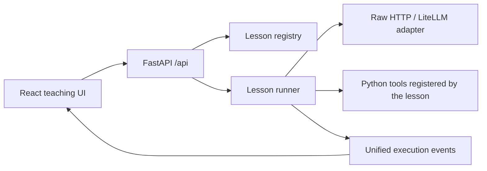

# Agent Learning Studio: architecture and long-term course design

**English** · [简体中文](platform.md)

> Translated from the Chinese original; if they disagree, the Chinese version is authoritative.

## Goals and current scope

Put lesson text, real Python source code, run inputs and execution evidence in one learning environment. Start by hand-writing the agent loop to understand the mechanism, then learn how frameworks wrap those mechanisms.

The web app offers source reading, preset exercises, real model calls, local program experiments, full JSON inspection and event replay. Lesson code is still edited in local files; changes take effect after you restart the Python server.

Reuse first: platform infrastructure uses mature dependencies. Before adding an editor, flow chart, persistence or framework capability, evaluate existing components and official adapters. The hand-written native loop carries the teaching job; the UI does not re-implement Markdown, code highlighting or SSE parsing.

There are 53 runnable lessons covering model-call basics, tool calling, tasks and interfaces, context and state (including prompt caching and Skills), reasoning and control patterns, retrieval, frameworks, quality and reliability, protocols and the capstone. The 29 newer lessons were run once against a real model (2026-10-21, see the [verification record](../verification/live-runs-2026-10-21.md)); `embedding-retrieval` and `hybrid-retrieval` have not been run with a real model. Lessons marked `planned` in the catalog cannot run and do not count as finished.

## Technology choices

| Layer | Choice | Why |
| --- | --- | --- |
| Teaching UI | React, TypeScript, Vite | Lessons, source, runs and replay have separate state; types help keep the event protocol consistent; a local app needs no server-side page rendering |
| Page and interaction components | Free React Bits (TS-TW variants first), shadcn/ui to fill gaps, Tailwind CSS 4 | Reuse animations, dropdowns, radios, switches and the replay slider; dialogs, drawers, tabs, accordions and form controls use ready-made accessible foundations |
| HTTP and event transport | FastAPI, POST + SSE | Stays within the Python ecosystem; after a question is submitted, inspectable run events are pushed one by one |
| Agent foundations | Native Python loop | Request construction, `tool_call_id`, tool results and the next round's messages can all be read directly |
| Model access | Raw HTTP teaching adapter + LiteLLM multi-provider SDK | The Bailian configuration keeps working; SDK-standardized input and output are never passed off as raw HTTP data |
| Internal test adapter | Deterministic responses + real Python tools | For automated regression only; the web app always makes real calls and guides you through configuration when no model is available |
| Verification | Python tests + Playwright | Checks both run semantics and real interaction in the browser |

The platform runs on local Python to support later LangChain, LangGraph, vector-store and local-file-tool lessons. The course draws on three reference tutorials: Microsoft's, Hugging Face's, and 《深入理解 AI Agent》 (a Chinese book on AI agent design). The reference repositories take no part in running the production app.

## Layering

The lesson page has five scenes: Understand, Code, Lab, Check and Review. See [Frontend structure](frontend-workspace.en.md). A new lesson only supplies data: `lesson.json` and `content.json` (v2). It keeps using the shared execution events and does not copy a whole page UI.

- `lessons/`: self-contained lesson prompts, tools and examples, one directory per lesson.
- `curriculum/catalog.json`: the complete tiered course plan. It is the shared data source for the catalog, lesson numbers and generated docs. Registering a plan does not grant permission to run it.
- `course/`: the native loop, model requests and run events. It does not depend on web components.
- `server/`: the lesson index, the source files allowed to be shown, HTTP input validation and the event stream.
- `frontend/`: lesson browsing, code display, run controls and replay. It does not decide tool-execution logic.
- `docs/architecture/`: reference evidence, architecture decisions and extension conventions.

## Event protocol

Each SSE `data:` is a standalone JSON object: `type`, `round`, `timestamp`, `data`, plus the v2 envelope fields (`run_id`, `seq`, span, source and representation level). A run is created with `POST /api/runs`. Its events are redacted and written to the server-side run store, then pushed by `GET /api/runs/{id}/events`, which supports resuming from a given `seq`. For the envelope, span rules and endpoints, see [Event envelope v2 and the run store](event-envelope-v2.en.md). One real execution produces one event sequence; replay only reads events that have already been received.

| Type | Teaching meaning | Main fields of `data` |
| --- | --- | --- |
| `run_start` | Execution source, lesson and mode | Run metadata |
| `request` | The full request body that was actually about to be sent | `body`; embedding requests also carry `endpoint: "embeddings"` |
| `response` | The raw response returned by the model | `body`, `duration_ms`; embedding responses also carry `endpoint`; the `response` of a streamed request is assembled by the platform from chunks and carries `stream` |
| `response_delta` | A group of chunks of a streamed response, as they really arrived | `chunks`, `chunk_range`, `received_ms`, `text` |
| `approval_requested` / `approval_resolved` | The run stopped at an approval point / the approval result | `approval_id`, `summary`, `payload`, `payload_digest` / `outcome`, `decided_by`, `note` |
| `checkpoint` | An execution position saved by the lesson | `checkpoint_id`, `name`, `state`, `state_digest` |
| `tool_call` | A function call proposed by the model | `id`, `function` |
| `tool_result` | The result of local Python execution | `tool_call_id`, `name`, `result` |
| `answer` | The final answer | `content` |
| `error` | An execution error | `message` |
| `done` | The end state | `status`, `duration_ms` |

Embedding requests come from `RunContext.embed` (Bailian over raw HTTP to `/embeddings`, other providers through `litellm.embedding`). They share the call budget and the representation of chat requests; vectors are recorded in full and only truncated for display. When the selected provider has no embedding model, the platform refuses with the error code `embedding_model_missing` instead of switching to another model. See "Embedding requests" in [Event envelope v2](event-envelope-v2.en.md) for the format.

A `request` event stores a snapshot of the messages at that moment; it must not change when the next round appends messages. "Full JSON" means the request body and the response body. Authentication keys are not part of the teaching record, and the backend redacts any real key found in events.

Cancelling stops later rounds and tool execution. An upstream HTTP request that has already been sent may continue until it returns or times out. Replay in the web app does not call the model and does not re-execute tools.

### Streaming, approvals and checkpoints

The three platform capabilities that later lessons need (streaming output and cancellation, hooks and approval gates, human in the loop and resume, plus coding agents, background tasks and capstone projects) all live on `RunContext`. Event formats are in section 7 of [Event envelope v2](event-envelope-v2.en.md); usage is in "How to use streaming, approvals and checkpoints" of [Adding lessons](adding-lessons.en.md):

- **Streaming**: `context.complete_stream(...)`. Bailian's raw HTTP sends `stream: true` (with `stream_options.include_usage` by default) and parses the SSE data lines chunk by chunk; LiteLLM uses `stream=True` and records the SDK's chunk objects. Chunks are read on a separate reader thread and the run thread checks for a stop every 50 ms, so a stop takes effect even while no new chunk arrives. Chunks are recorded as they are and merged by time (0.25 s by default) or count (40 by default) into `response_delta` events, the first chunk alone; at the end the platform assembles the chunks into one `response` that states `assembled_from_chunks`, how the stream ended and why it stopped. The web app joins the text that has arrived exactly as the events say, with no typewriter effect.
- **Approvals**: `context.request_approval(...)` records `approval_requested`, the run status becomes `paused`, and the web app shows an approve / reject card (with an optional reason, and editable arguments when `editable`). `POST /api/runs/{id}/approvals` submits the decision, and the run thread records it as `approval_resolved` and continues. Timeout and stop each have an explicit result. Offline test decisions come from the lesson fixture `testing.approval_factory` or an `approval_policy` injected by a test; the student web app has no simulation entry.
- **Checkpoints and resume**: `context.checkpoint(name, state)` records the state in the run store; `POST /api/runs/{id}/resume` starts a new run from a checkpoint (the new run records `resumed_from` and `thread_id`, and the lesson reads `context.resume_state`). Resume does not replay model requests; every later request is a real new request. Resume still works after a service restart.
- **Why a run stopped**: `cancel` accepts a `reason` (`user_stop`, `page_closed`), written to `done.data.cancel_reason`; a dropped event-reading connection is not a stop and is only counted in `done.data.client_disconnects`.

## Adding a lesson

For the full process see [Adding lessons and independent customization](adding-lessons.en.md). For how to write terms and code names see [Terms and code names](terminology.en.md). In short:

1. Register the lesson in `curriculum/catalog.json` (status `planned`) and generate the lesson directory with `scripts/new_lesson.py`.
2. In the lesson's `lesson.json`, declare the sources, exercises, runner and test fixtures. The backend discovers it automatically; title, goals and status come from the catalog.
3. Write the minimal implementation and `test_lesson.py`. Tests use deterministic model data, but the tools must really execute.
4. Write `content.json` (v2) with four scenes: Understand, Code, Lab and Check. The observation points in the Lab scene must be hit by deterministic runs.
5. Run `validate_lessons.py`, `term_report.py` and the full test suite. Only after acceptance does the status change to `available`.

Lessons follow **concept → minimal implementation → run evidence → experiment → self-check**. The self-check asks learners to explain behavior, not just recite function names.

## Conventions for framework lessons

LangChain and LangGraph are added as dependencies when later lessons really need them. A lesson's runner can be swapped, and the frontend keeps consuming the unified events: framework model callbacks map to `request`/`response`, tool callbacks map to `tool_call`/`tool_result`, and the final result maps to `answer`. If a framework cannot provide the raw request, the UI must label what it shows as framework input, not pass it off as an HTTP request body.

Nodes, state and checkpoints in graph execution may extend the event fields, with explicit version migration. Do not hide graph branching, concurrency or recovery semantics just to fit the basic lessons' loop. When adding a framework, first build a standalone adapter with protocol tests, then plug it into the lesson registry.

### The framework adapter and the "framework input" label

Framework dependencies are main dependencies in `pyproject.toml` (`langchain-core`, `langgraph`, `mcp`, `a2a-sdk[http-server]`; version bounds and licenses are in `THIRD_PARTY_NOTICES.md`). The full `langchain` package and provider integration packages are not installed. The adapter lives in `course/frameworks.py`, its protocol tests in `tests/test_frameworks.py`:

- `RunContextChatModel(context=context)` is a LangChain `BaseChatModel`. Every model call the framework makes goes through `RunContext.complete`, so it is recorded as `request`/`response`, counts against `max_model_calls` and stops on cancellation. `bind_tools` and `with_structured_output` convert framework tools to OpenAI-compatible tool definitions. Each call takes the run's next round number; pass `round_number` or `branch` to the call to choose the round or a parallel branch. LangGraph nodes use the same model.
- Each call adds one lesson event before and one after, keeping two layers apart. `lesson.framework_input` (`layer: "framework_input"`) records the messages, tool names and options the framework holds: framework input before conversion, not a request body. `lesson.framework_output` (`layer: "framework_output"`) records the AIMessage the framework builds from the response. The `request` between them is the body the adapter converted; its `representation` still comes from the run path (`http_body` for Bailian, `sdk_standardized` for LiteLLM) and is not relabelled because a framework produced it.
- When the provider sends a call without an id, the adapter assigns `framework_call_<call>_<n>` and lists it in `synthesized_call_ids`. Calls whose arguments are not a JSON object go to `invalid_tool_calls` instead of being dropped. When the provider reports no usage, `usage_reported` is `false`; no 0 is filled in.
- Run tools with `execute_tool_calls(context, ai_message, tools)`: it calls `RunContext.execute_proposal` for each call, producing `tool_call`/`tool_result`, and submits invalid calls with their raw arguments so they get a structured error. Do not use LangGraph's prebuilt `ToolNode` in course runs: it calls tools directly and bypasses the event record. `tools_as_callables` turns LangChain tools into the allowlist, and a `ToolException` becomes an `ok=false` result.
- `stream_graph(context, graph, inputs, config=...)` runs a compiled graph step by step, records each node's state update as `lesson.graph_update` (`step`, `node`, `update`) and checks cancellation between steps; bound the graph's own loops with `recursion_limit`. The optional `RunContextCallbackHandler` records framework callbacks as `lesson.framework_callback` with names and nesting only; run ids become `fw-1`, `fw-2`... in order of appearance.
- LangSmith tracing would upload framework inputs to an external service. Course runs record locally only: put framework code inside `local_tracing_only()` (`stream_graph` already does), and the model adapter refuses to send a request while tracing is on.
- Protocol lessons (MCP, A2A) use `course/protocols.py` (its tests in `tests/test_protocols.py` start real local processes). `run_until_cancelled(context, session)` turns a stopped run into async cancellation, so the SDK closes the connection and reaps the child process before `RunCancelled` is raised. `python_module_server` and `spawn_local_service` start servers only from modules under the `lessons.` package; child processes inherit only the SDK's list of safe environment variables, never the keys in the parent's environment; an A2A service binds a free port on 127.0.0.1 itself. `recording_stdio` records every MCP JSON-RPC message as `lesson.mcp_message`; `captured: "sdk_session_message"` says it is the SDK message object dumped with protocol field names, not the raw byte stream. Protocol messages never go into `request`/`response`, which are for model calls only.
- All of this is lesson events and data fields; no envelope constant changed, and replays and recordings treat them as ordinary `lesson.*` events.

## Suggested course path

Lesson numbers, prerequisites, experiments and pass criteria are defined in the [course plan](../course-plan.en.md). The table below keeps only the stage-level architecture mapping.

| Stage | Lesson topics | Acceptance exercise |
| --- | --- | --- |
| Existing foundations | 01 tool selection, 02 dependent calls, 03 failures and boundaries | Explain the two-round and three-round requests, locate `tool_call_id`, show that a failure was not treated as a result |
| State | Task goals and acceptance, multi-turn conversation, context and memory; prompt comparison, context ablation and compaction | Tell messages, state and cross-session memory apart; change one variable under fixed conditions and check whether message validity, evidence and to-dos survive |
| Retrieval | Retrieval tools, RAG and citations; keyword, vector and hybrid retrieval and knowledge updates | Check recall and answers separately; compare against answers grounded in retrieval results, and say so explicitly when evidence is missing |
| Frameworks | LangChain, LangGraph; the Model/Harness/Environment boundary | Compare against the native loop on the same task; implement branching, pause and resume, and explain exactly which mechanisms the framework wraps |
| Quality | Independent result verification, evaluation and regression, observability and cost; failure attribution and version improvement | Record separately whether the run finished, the task was correct, the evidence was sufficient and the process was violation-free; on a fixed task set compare success rate, latency and actual usage, and label estimates and unknowns separately |
| Capstone | Multi-agent, MCP and project practice; context isolation, deployment and recovery | Compare task quality and call cost for one agent versus several; split tasks in an explainable way, bound the number of rounds, and verify the final result and service readiness |

This is a capability overview. The formal catalog is split into categories, modules and lessons (the lesson count follows the [course outline](../course-plan.en.md)). To change it, edit `curriculum/catalog.json` and regenerate the main table; the web app uses the same data automatically. Framework and service APIs change, so re-check the official docs when developing the corresponding lessons.

For the specific sources, code checks and license boundaries of 《深入理解 AI Agent：设计原理与工程实践》 (Understanding AI Agents: Design Principles and Engineering Practice), see [Course sources](reference-study.en.md). Task goals and acceptance, context sources and ablation, and controlled comparison of prompts and tool descriptions are already implemented in `task-contract`, `messages-context` and `prompt-experiments` respectively; fuller system-level evaluation comes later in the quality stage. The native-Python parts — message construction, tool dispatch, return values and stop conditions — still have to be read, changed and verified; frameworks come after those mechanisms are understood.

## Local running and data boundaries

The server binds to `127.0.0.1`. Model configuration stays in `local_config.py`. API keys come from the Python process's environment variables or from temporary in-memory values submitted to the backend through the web app.

The first version targets single-user local learning. Only one run executes at a time. Run records are stored in `.runtime/runs.sqlite3` (redacted events only, clearable in one click). Learning progress is stored separately in the browser's localStorage and records only real actions on this machine. Model configuration is kept in backend memory per provider, each using its own environment variables or temporary key; switching providers does not share the Bailian key. For the multi-provider implementation see [Model access notes](multi-provider-review.en.md). If shared deployment, user accounts, persisted traces or in-browser code execution are ever needed, design authentication, storage and execution isolation separately.
