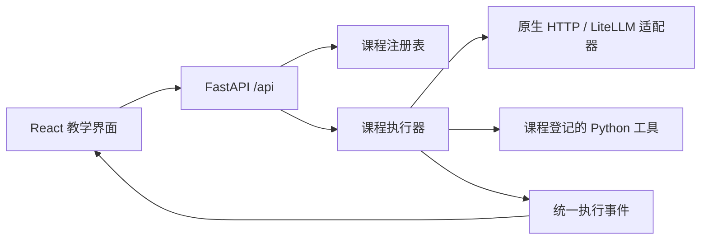

# Agent Learning Studio：架构与长期课程设计

## 目标与当前边界

把课程讲解、真实 Python 源码、运行输入和执行证据放在同一学习环境中。先从手写 Agent 循环理解机制，再学习框架如何封装这些机制。

当前第 1–10 课已接入：原生循环三课、任务与接口三课、上下文与状态四课。网页提供源码阅读、预设练习、真实模型调用、本地程序实验、完整 JSON 检查和事件回放。课程代码仍在本地文件中编辑，修改后重启 Python 服务生效。

复用优先：平台基础设施采用成熟依赖；新增编辑器、流程图、持久化或框架能力时，先评估现有组件与官方适配器。手写原生循环承担教学职责，业务界面不重复实现 Markdown、代码高亮或 SSE 语法解析。

状态、上下文与 SQLite 记忆已作为第 7–10 课教学实现。后续阶段继续加入检索、框架和系统评估；目录中仍为 planned 的课程不能运行，也不计作已完成课程。

## 技术选择

| 层 | 选择 | 原因 |
| --- | --- | --- |
| 教学界面 | React、TypeScript、Vite | 课程、源码、运行和回放有独立状态；类型帮助保持事件协议一致，本地应用无需服务端网页渲染 |
| 页面与交互组件 | React Bits 免费 TS-TW 优先，shadcn/ui 按需补齐，Tailwind CSS 4 | 复用动画、下拉、单选、开关与回放滑块；对话框、抽屉、Tabs、Accordion 与表单控件使用现成可访问性基础 |
| HTTP 与事件传输 | FastAPI、POST + SSE | 保持现有 Python 生态，输入问题后逐条推送可检查的运行事件 |
| Agent 基础课 | 原生 Python 循环 | 请求构造、tool_call_id、工具返回和下一轮消息都能直接阅读 |
| 模型接入 | 原生 HTTP 教学适配器 + LiteLLM 多供应商 SDK | 百炼配置保持可用；标准化 SDK 输入输出不冒充原始 HTTP 数据 |
| 内部测试适配器 | 确定性响应 + 真实 Python 工具 | 仅用于自动化回归；网页实操固定真实调用，无模型时引导配置 |
| 验证 | Python 测试 + Playwright | 同时检查运行语义与浏览器中的真实交互 |

本平台选择本机 Python，以支持后续 LangChain、LangGraph、向量库以及本地文件工具。课程参考 Microsoft、Hugging Face 和《深入理解 AI Agent》三份教程；参考仓库不参与生产应用运行。

## 分层约定

当前前端采用独立的学习与实验工作区，结构见 [前端工作区](frontend-workspace.md)。新增课程继续使用既有课程数据与统一执行事件，不需要复制整页 UI。

- `lessons/`：可独立阅读的课程提示词、工具与示例；一课一个目录。
- `curriculum/catalog.json`：完整分层课程计划，是目录、课号和生成文档的共同数据源；登记计划不自动获得执行权限。
- `course/`：原生循环、模型请求和运行事件；不依赖网页组件。
- `server/`：课程索引、允许展示的源码、HTTP 输入校验与事件流。
- `frontend/`：课程浏览、代码显示、运行控制与回放；不决定工具执行逻辑。
- `docs/architecture/`：参考证据、架构决定和扩展约定。

## 事件协议

每条 SSE `data:` 是一个独立 JSON 对象：`type`、`round`、`timestamp`、`data`。一次实际执行生成一次事件序列；回放只读取浏览器已经收到的事件。

| 类型 | 教学意义 | data 的主要字段 |
| --- | --- | --- |
| `run_start` | 执行来源、课程与模式 | 运行元数据 |
| `request` | 实际准备发送的完整请求体 | `body` |
| `response` | 模型返回的原始响应 | `body`、`duration_ms` |
| `tool_call` | 模型提出的函数调用 | `id`、`function` |
| `tool_result` | 本机 Python 执行结果 | `tool_call_id`、`name`、`result` |
| `answer` | 最终回答 | `content` |
| `error` | 执行错误 | `message` |
| `done` | 结束状态 | `status`、`duration_ms` |

请求事件保存当时的消息快照，不能随着下一轮追加消息而变化。完整 JSON 指请求体与响应体，认证密钥不属于教学记录。后端对事件中的实际密钥做脱敏。

中止会阻止后续轮次与工具执行；已经发送的上游 HTTP 请求可能继续直到返回或超时。网页回放不调用模型，也不重新执行工具。

## 新增课程流程

1. 在 `lessons/lesson_NN_topic/` 放入课程源码和 README，清晰写出目标、先修、例子、观察点和练习；添加 `content.json`，用 `sections` 写原理段、`observe` 写观察点、`quiz` 写单选题、正确选项及解释。
2. 在课内 `lesson.json` 声明 ID、练习、源码白名单、输入预设和执行配置；平台注册器自动发现清单，标题/目标/状态以 `curriculum/catalog.json` 为准。
3. 接入真实模型，允许用户自行提问；内部测试可提供确定性模型替身，以便验证协议和故障，不把它列为学生实操模式。
4. 为关键行为添加验证，例如参数是否来自前一工具、失败是否被正确回传。
5. 使用 `scripts/validate_lessons.py` 校验，在网页检查源码、事件、错误和最终答案，再把路线图项改为可学习。完整作者流程与复杂课程定制见 [新增课程指南](adding-lessons.md)。

课程 README 推荐采用：**问题 → 最小实现 → 运行证据 → 预测练习 → 改动实验 → 自检**。自检要求解释行为，不只背诵函数名称。

## 框架课程接入约定

LangChain 和 LangGraph 在后续课程确有需要时加入依赖。课程的执行器可以替换，前端继续消费统一事件：框架模型回调映射为 `request/response`，工具回调映射为 `tool_call/tool_result`，最终结果映射为 `answer`。若框架不能提供原始请求，则必须标注所展示的是框架输入，不能冒充 HTTP 请求体。

图执行中的节点、状态和检查点可扩展事件字段，并明确版本迁移。不要为了适配基础课程的循环，隐藏图分支、并发或恢复语义。新增框架时先实现独立适配器及协议测试，再接入课程注册表。

## 建议课程路径

具体课号、先修关系、实验与过关标准以 [课程主表](../course-plan.md) 为准。下表只保留阶段层面的架构映射。

| 阶段 | 课程主题 | 验收练习 |
| --- | --- | --- |
| 已有基础 | 01 工具选择、02 依赖调用、03 失败与边界 | 解释两轮/三轮请求，定位 `tool_call_id`，证明失败未被当成结果 |
| 状态 | 任务目标与验收、多轮对话、上下文与记忆；提示词对照、上下文消融与压缩 | 区分 messages、state 与跨会话 memory；固定条件下改一个变量，检查消息合法性、证据与待办是否保留 |
| 检索 | 检索工具、RAG 与引用；关键词/向量/混合检索与知识更新 | 分别检查召回与回答；对照检索结果回答，缺少证据时明确说明 |
| 框架 | LangChain、LangGraph；Model/Harness/Environment 边界 | 用相同任务对照原生循环；实现分支、暂停与恢复，说明框架具体封装了哪些机制 |
| 质量 | 独立结果验证、评估与回归、可观测性与成本；失败归因与版本改进 | 分开记录运行结束、任务正确、证据充分和过程违规；固定任务集比较成功率、延迟、实际用量，估算和未知单独标识 |
| 综合 | 多 Agent、MCP 与项目实践；上下文隔离、部署与恢复 | 比较单/多 Agent 的任务质量与调用成本；可解释地拆分任务，控制轮数，验证最终结果与服务就绪 |

这些为能力概览。正式目录现已细分为 8 大类、19 小模块、29 课与 6 个选修分支，调整时修改 `curriculum/catalog.json` 并生成主表，网页自动使用同一份数据。框架和服务 API 会变化，正式开发对应课程时重新核对官方文档。

《深入理解 AI Agent：设计原理与工程实践》的具体来源、代码核查与许可边界见 [课程来源](reference-study.md)。任务目标与验收、上下文来源与消融、提示词/工具描述受控对照已经分别实现于第 4、7、6 课；更完整的系统评估仍在后续质量阶段展开。原生 Python 的消息构造、工具分派、返回值和停止条件仍需读懂、改动、验证，框架在这些机制掌握后引入。

## 本地运行与数据边界

服务绑定 `127.0.0.1`，模型配置保留在 `local_config.py`，API Key 使用 Python 进程环境变量或网页提交到后端的临时内存。源码 API 只公开登记的课程文件，不提供任意路径读取或任意代码执行。

首版面向单人本地学习：单次运行互斥，轨迹在页面中保留，刷新不承诺恢复。模型配置按服务商分别保存在后端内存，各自使用对应环境变量或临时密钥；切换服务商不共享百炼密钥。多供应商实现见 [模型接入说明](multi-provider-review.md)。将来若需要共享部署、用户账户、持久化轨迹或网页代码执行，应单独设计身份验证、存储与执行隔离。
